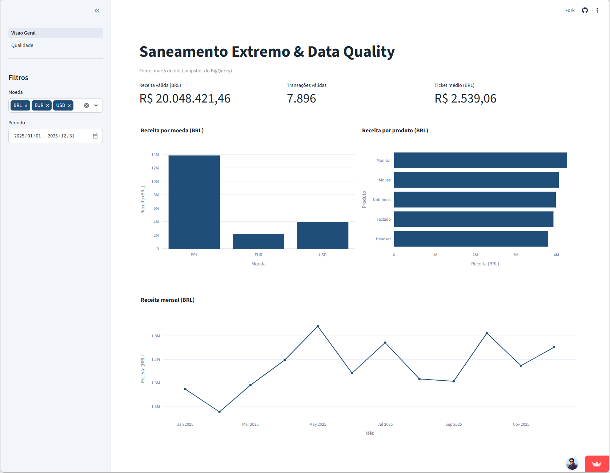
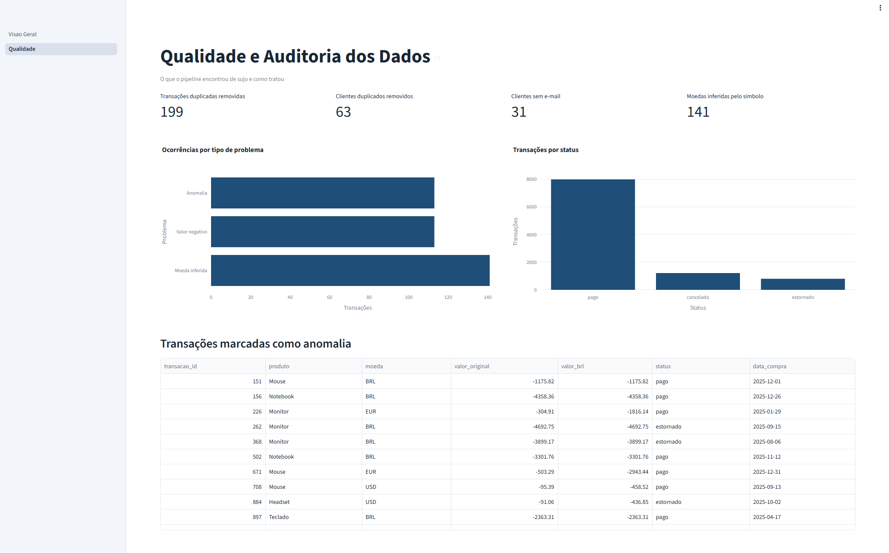
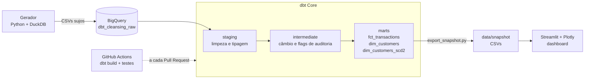
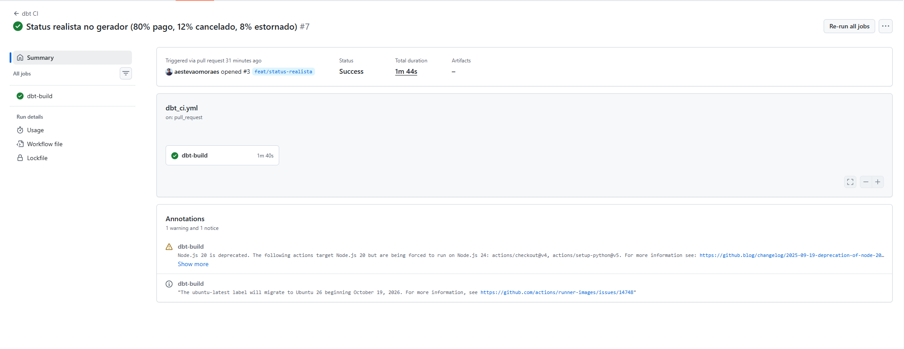
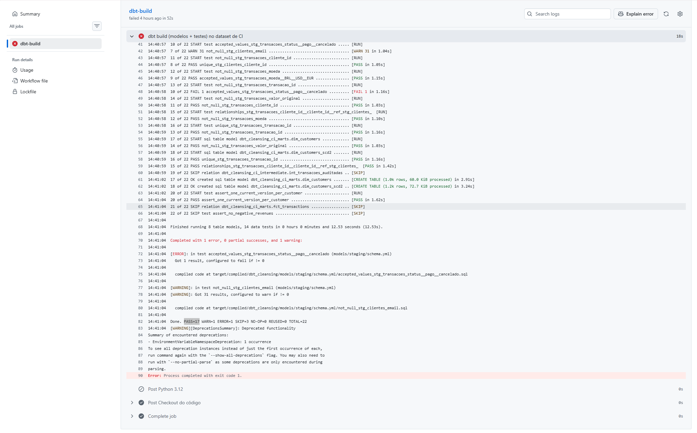

# Saneamento Extremo & Data Quality — dbt + BigQuery

[](https://github.com/aestevaomoraes/extreme-data-cleansing-dbt-bigquery/actions/workflows/dbt_ci.yml)
[](https://saneamento-extremo-dbt.streamlit.app)

> Pipeline de Analytics Engineering de ponta a ponta: gera dados propositalmente corrompidos, sanea tudo com **dbt** no **BigQuery**, valida a qualidade na **CI** e publica um dashboard com KPIs de negócio e auditoria dos dados.

**Dashboard ao vivo:** https://saneamento-extremo-dbt.streamlit.app

## Demo

| Visão Geral (negócio) | Qualidade e Auditoria |
|---|---|
|  |  |

## O problema

Dados reais chegam sujos. Este projeto simula isso de forma controlada: um gerador em Python/DuckDB cria clientes, transações, câmbio e histórico de endereços com defeitos injetados, e o pipeline precisa recuperar números confiáveis.

| Sujeira injetada | Como aparece | Tratamento |
|---|---|---|
| Clientes duplicados | 1.063 linhas para 1.000 clientes | Deduplicação com `QUALIFY ROW_NUMBER()` |
| Transações duplicadas | 10.199 linhas para 10.000 transações | Deduplicação por `transacao_id` |
| Texto desformatado | Nomes em caixa alta, espaços sobrando | `TRIM`, `LOWER`, `INITCAP` |
| Datas em formatos mistos | Duas representações na mesma coluna | `COALESCE` de vários `SAFE.PARSE_DATE` |
| Valores em texto com símbolo | `R$ 1234,56`, `$1234.56`, `€ 1234,56` | Macro `safe_currency` |
| Moeda ausente ou em minúsculas | `NULL`, `usd` | `UPPER` e inferência pelo símbolo (`flag_moeda_inferida`) |
| E-mails ausentes | ~3% dos clientes | Mantidos, com teste em nível `warn` |
| Valores negativos | ~1% das transações | `flag_valor_negativo` e exclusão da receita válida |
| Status com ruído | Caixa alta e espaços | Normalização e teste `accepted_values` |

## Arquitetura



### Camadas do dbt

| Camada | Dataset | Modelos | Função |
|---|---|---|---|
| raw | `dbt_cleansing_raw` | 4 tabelas, todas em `STRING` | Carga fiel dos CSVs, sem perder nada na ingestão |
| staging | `dbt_cleansing_staging` | `stg_clientes`, `stg_transacoes`, `stg_cambio`, `stg_clientes_historico` | Limpar, tipar e deduplicar |
| intermediate | `dbt_cleansing_intermediate` | `int_transacoes_auditadas` | Aplicar câmbio, calcular `valor_brl` e as flags de auditoria |
| marts | `dbt_cleansing_marts` | `fct_transactions`, `dim_customers`, `dim_customers_scd2` | Tabelas finais para consumo |

## Decisões de modelagem

### Multimoeda com câmbio diário
- As transações vêm em BRL, USD e EUR, com formatos sujos (`R$ 1234,56`, `$1234.56`, `€ 1234,56`).
- Quando a coluna `moeda` está vazia, a moeda é **inferida pelo símbolo** e a linha recebe `flag_moeda_inferida`. O símbolo original fica em `simbolo_original` para auditoria.
- A tabela `stg_cambio` guarda a taxa diária de cada moeda para BRL (730 linhas: 365 dias × 2 moedas). Para BRL a taxa é 1.
- `valor_brl = round(valor_original × taxa_do_dia, 2)`. Sem taxa disponível, a transação fica fora da receita válida.

### SCD Tipo 2 em SQL puro
- `dim_customers_scd2` guarda o histórico de cidade de cada cliente: 1.197 versões para 1.000 clientes.
- Cada versão tem `valid_from`, `valid_to` (`9999-12-31` para a versão atual), `is_current` e uma chave substituta `cliente_sk` (hash MD5 de `cliente_id` + `valid_from`).
- A tabela fato liga cada compra à versão do cliente **vigente na data da compra** (`data_compra BETWEEN valid_from AND valid_to`), então `cidade_na_compra` reflete onde o cliente morava na época.
- Foi feito com `LEAD()` e não com `dbt snapshot`, porque o snapshot depende de `MERGE`/DML, que o BigQuery sandbox não oferece.

### Particionamento por faixa
- `fct_transactions` é particionada por **faixa de inteiros** em `cliente_id` (0 a 1.100, intervalo de 100) e clusterizada por `status` e `data_compra`.
- A primeira tentativa foi partição por data. No sandbox, as partições de 2025 expiraram sozinhas e a tabela ficou com 0 linhas, sem nenhum erro. A partição por faixa de inteiros não expira e resolveu o problema.

### Deduplicação determinística

As transações duplicadas não são cópias exatas: em 106 `transacao_id` as versões ainda divergem depois da limpeza (valor, símbolo da moeda e flag de moeda inferida). Sem desempate, o BigQuery escolhia uma versão arbitrária e o resultado podia mudar entre builds (ponto levantado por um leitor do post no LinkedIn).

O `stg_transacoes` agora desempata em camadas:
1. `data_compra` mais recente;
2. valor não negativo (negativo é defeito marcado);
3. moeda informada, em vez de inferida;
4. valor escrito com símbolo de moeda;
5. hash da linha, só como rede de segurança.

A limpeza ficou em `stg_transacoes_limpo` (modelo efêmero) e a deduplicação em `stg_transacoes`. O teste `assert_duplicatas_sem_empate_arbitrario` falha se sobrar empate entre versões diferentes, e foi validado por sabotagem (falhou com 93 casos ao remover um critério).

Impacto medido: 50 de 10.000 linhas mudaram. Receita, transações e ticket ficaram iguais; moedas inferidas passaram de 147 para 141 e valores negativos de 114 para 113.

## Qualidade e testes

- **15 testes de dados**: genéricos (`unique`, `not_null`, `accepted_values`, `relationships`) e 3 singulares em SQL (`assert_no_negative_revenues`, `assert_one_current_version_per_customer` e `assert_duplicatas_sem_empate_arbitrario`).
- **Severidade**: e-mail ausente é `warn` (31 clientes), porque é um problema conhecido que não deve bloquear o pipeline. O restante é `error`.
- **Resultado atual**: `PASS=22 WARN=1 ERROR=0` (9 modelos, sendo 1 efêmero, e 15 testes).

### CI com GitHub Actions
- A cada Pull Request, o workflow `dbt_ci.yml` roda `dbt build --target ci` num dataset separado (`dbt_cleansing_ci`), com uma service account de privilégio mínimo (BigQuery Job User e Data Editor), guardada como secret do repositório.
- **Teste de sabotagem**: ao remover `estornado` da lista de `accepted_values` do status, a CI falhou (`FAIL 1`) e os modelos dependentes foram pulados (`SKIP`). Depois de desfazer a mudança, ficou verde de novo.

| CI verde | CI vermelha (teste falhando) |
|---|---|
|  |  |

## Dashboard

App em **Streamlit + Plotly** com duas páginas: **Visão Geral** (receita, ticket médio, receita por moeda, produto e mês, com filtros de moeda e período) e **Qualidade e Auditoria** (duplicatas removidas, e-mails ausentes, moedas inferidas, anomalias e distribuição de status).

O app lê um **snapshot em CSV** dos marts (`data/snapshot/`), e não o BigQuery direto. Assim ele roda em qualquer lugar, sem credenciais, sem custo por consulta e sem depender das tabelas do sandbox, que expiram.

> O snapshot deve ser regenerado sempre na ordem **`dbt build` e depois `export_snapshot.py`**. Fora de ordem, o dashboard pode misturar tabelas de gerações diferentes dos dados.

## Como rodar

Pré-requisitos: projeto no Google Cloud com o BigQuery em modo sandbox (sem faturamento), Python 3.12+ e o `gcloud` instalado. Foi desenvolvido no GitHub Codespaces.

```bash
# 1. Ambiente
python -m venv .venv && source .venv/bin/activate
pip install -r requirements.txt

# 2. Autenticação no Google Cloud
gcloud auth application-default login
gcloud auth application-default set-quota-project SEU_PROJETO

# 3. Dados sujos (reprodutíveis, seed fixa) e carga na camada raw
python scripts/generate_corrupted_data.py
python scripts/load_to_bigquery.py

# 4. Transformação e testes
cd dbt_cleansing
export DBT_ENGINE_MANAGE_STATE=false
dbt build
cd ..

# 5. Snapshot e dashboard
python scripts/export_snapshot.py
pip install -r app/requirements.txt
streamlit run app/Visao_Geral.py
```

Antes de rodar, troque o ID do projeto (`projeto-sql-492802`) em `scripts/load_to_bigquery.py`, `scripts/export_snapshot.py` e `dbt_cleansing/profiles.yml`. O `export DBT_ENGINE_MANAGE_STATE=false` evita que o dbt peça login num serviço pago (dbt State).

Para só ver o dashboard, basta o último bloco: o snapshot já está versionado no repositório.

## Restrições do BigQuery sandbox

O projeto foi feito **sem faturamento**, e isso moldou várias decisões:

- **Sem DML, `MERGE` ou streaming**: por isso o SCD2 é feito com `LEAD()` e não com `dbt snapshot`.
- **Tabelas expiram em 60 dias**: para reconstruir tudo, basta rodar o pipeline de novo.
- **Partições por data expiram sozinhas**: por isso a tabela fato usa partição por faixa de inteiros.
- **Dashboard sem BigQuery**: por isso o snapshot em CSV.

## Estrutura do repositório

```text
.
├── .github/workflows/dbt_ci.yml     # CI: dbt build a cada Pull Request
├── .streamlit/config.toml           # tema corporativo do dashboard
├── app/
│   ├── Visao_Geral.py               # página principal (KPIs de negócio)
│   ├── pages/2_Qualidade.py         # página de auditoria de qualidade
│   └── requirements.txt
├── data/
│   └── snapshot/                    # CSVs dos marts lidos pelo dashboard
├── dbt_cleansing/
│   ├── macros/safe_currency.sql     # limpeza de valores monetários
│   ├── models/                      # staging, intermediate e marts
│   ├── tests/                       # testes singulares em SQL
│   ├── dbt_project.yml
│   └── profiles.yml                 # targets dev (oauth) e ci (service account)
├── docs/screenshots/                # prints usados neste README
├── scripts/
│   ├── generate_corrupted_data.py   # gera os dados sujos (DuckDB)
│   ├── load_to_bigquery.py          # carga na camada raw
│   └── export_snapshot.py           # exporta os marts para CSV
└── requirements.txt
```

Os dados brutos (`data/raw/`) são gerados localmente e ficam fora do Git.

## Melhorias futuras

- Centralizar os critérios de desempate em uma macro, para não duplicá-los entre o modelo e o teste.
- Expor no fato mais flags de auditoria já calculadas na camada intermediate (como compra antes do cadastro). Hoje `flag_anomalia` coincide com `flag_valor_negativo`.
- Testes nos marts, como `relationships` entre a tabela fato e a dimensão SCD2.
- Modelos incrementais e documentação gerada com `dbt docs`.
- Eixo do gráfico mensal iniciando em zero.

## Evidências no BigQuery

Prints do console do BigQuery com as tabelas geradas pelo pipeline:

- [bigquery_fct_transactions.png](docs/screenshots/bigquery_fct_transactions.png)
- [bigquery_int_transacoes_auditadas.png](docs/screenshots/bigquery_int_transacoes_auditadas.png)
- [bigquery_stg_transacoes.png](docs/screenshots/bigquery_stg_transacoes.png)
- [bigquery_tabelas_marts.png](docs/screenshots/bigquery_tabelas_marts.png)

## Autor

**Antônio** — [GitHub](https://github.com/aestevaomoraes)

Licença: veja o arquivo `LICENSE`.
